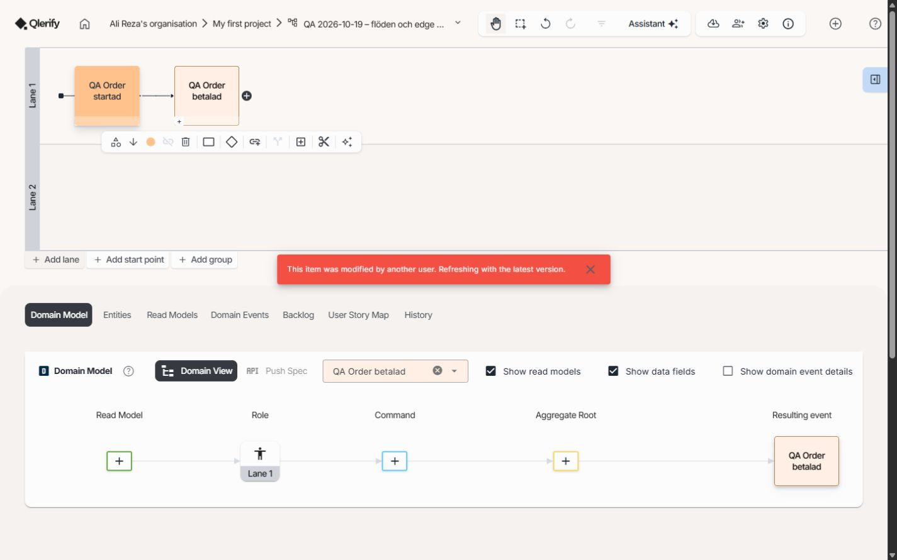
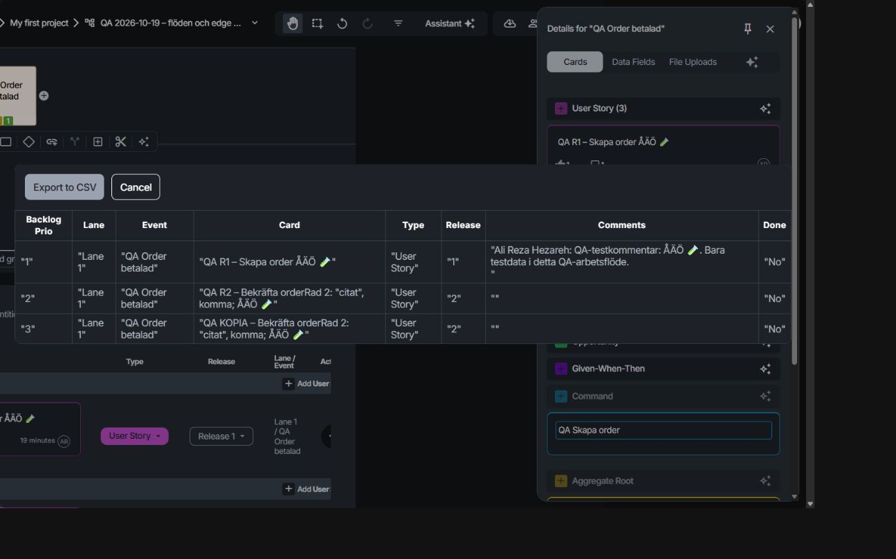

# Qlerify – testrapport, andra omgången 2026-10-19

## 1. Sammanfattning

Jag skapade ett nytt arbetsflöde och testade vanliga och negativa användarflöden med egna testdata. Två nya fel hittades: en snabb följd av ändringar tappar den andra åtgärden och CSV-förhandsvisningen slår ihop två textrader utan mellanrum.

| Resultat | Antal |
| --- | --- |
| Dokumenterade kontrollpunkter | 48 |
| Körda med slutligt Pass eller Fail | 39 |
| Pass | 37 |
| Fail | 2 |
| Blocked | 5 |
| Ej körda | 4 |

Pass rate: 37 / 39 × 100 = 94,87 %. Fail rate: 2 / 39 × 100 = 5,13 %. Blocked och Ej körda ingår inte i nämnaren. Kontrollpunkterna är manuella kontroller, inte 39 automatiska testfall. Upprepade försök med samma kontroll räknas en gång.

QA-ansvarig: Ali Reza Hezareh – testerna är inte godkända.

## 2. Omfattning och miljö

| Uppgift | Underlag |
| --- | --- |
| Datum | 2026-10-19 |
| Miljö | Qlerifys skarpa webbapp, befintlig inloggad session |
| Plattform | Windows, inbyggd Chromium-baserad webbläsare |
| Appversion | Observerad resurs: app.9855aa4c.js. Release- eller byggnummer visades inte. |
| Skärm | Skrivbordsvy. Inställningen 1440 × 900 gav vid senare DOM-avläsning 1309 × 818 CSS-pixlar. Exakt jämförbar skärmmiljö är därför inte fastställd. |
| Testobjekt | QA 2026-10-19 – flöden och edge cases 2 |
| Testdata | Två händelser, två banor, tre User Story-kort, två entiteter, Command, Aggregate Root, Read Model och Domain Event |
| Inspelning | Skärmbilder och textbevis sparades. Ingen video spelades in. |

[Öppna det nya QA-arbetsflödet](https://app.qlerify.com/workflow/8cc598e8-dd91-497c-aaa1-5e62ac66a36f/e9a7ff7a-1ced-42d9-87e6-2dc106d12e03).

Jag testade skapande, redigering, lagring efter omladdning, snabb följd av ändringar, releaser, filter, sökning, duplicering, Done/Reopen, kommentarer, röstning, entitetsfält, relationer, modellkopplingar, exportförhandsvisning, bilagelänk, historik och Ångra/Gör om.

Jag ändrade bara syntetiska data i det nya QA-arbetsflödet. Jag loggade inte in, ändrade inga behörigheter och skickade inga inbjudningar. Appens källkod ändrades inte. Tidigare fynd i den första rapporten räknas inte som omtestade mot den här resursversionen.

## 3. Detaljerade testresultat

| ID | Kontroll | Status | Förväntat och faktiskt resultat | Bugg/bevis |
| --- | --- | --- | --- | --- |
| R2-001 | Dashboard och nytt arbetsflöde | Pass | Nytt namngivet arbetsflöde skapades i My first project och öppnades. | Slutbild |
| R2-002 | Startpunkt och kopplad händelse | Pass | Två händelser skapades med en synlig koppling. | Slutbild |
| R2-003 | Ändra händelsens namn | Pass | QA Order startad och QA Order betalad visades och sparades. | Historik |
| R2-004 | Namnändring direkt följd av Add lane | Fail | Båda åtgärderna skulle sparas eller den nya åtgärden stoppas tydligt. Namnet sparades men banan saknades och en konflikt visades. Två försök gav samma fel. | APP-005 |
| R2-005 | Add lane efter avslutad lagring | Pass | Lane 2 skapades vid en separat åtgärd. | APP-005 kontrollförsök |
| R2-006 | Omladdning av arbetsflödet | Pass | Namn, två händelser och två banor fanns kvar. Ingen Lane 3 fanns efter den misslyckade följdåtgärden. | APP-005 efter omladdning |
| R2-007 | Skapa User Story-kort | Pass | Kort skapades och kopplades till QA Order betalad. | Historik |
| R2-008 | ÅÄÖ, emoji, citattecken och två textrader | Pass | Kortets två stycken och tecken fanns kvar i backloggen efter omladdning. | CSV-underlag och slutbild |
| R2-009 | Tilldela Release 1 och Release 2 | Pass | Kortens releaser visades i backlogg och User Story Map. | Filterbevis |
| R2-010 | Filtrera bara Release 1 | Pass | Bara R1-kortet visades i kartan. | Filterbevis |
| R2-011 | Filtrera bara Release 2 | Pass | Bara R2-kortet visades före duplicering. | Filterbevis |
| R2-012 | Filtrera båda releaserna | Pass | Båda korten visades. | Filterbevis |
| R2-013 | Rensa releasefilter | Pass | Båda korten kom tillbaka. | Filterbevis |
| R2-014 | Duplicera ett kort | Pass | Kopian behöll text, radbrytning, tecken, typ, release och händelse. Kopian kunde namnändras separat. | Historik och CSV-underlag |
| R2-015 | Markera kort som Done | Pass | Kortet doldes när Show Done var avstängt. | Historik |
| R2-016 | Visa slutfört kort | Pass | Det slutförda kortet kunde visas med Show Done. Ingen bedömning gjordes av om aktiva kort också ska visas i det läget. | Historik |
| R2-017 | Reopen | Pass | Kortet blev aktivt igen och visades när Show Done stängdes av. | Historik |
| R2-018 | Rösta på kort | Pass | En röst visades och fanns kvar efter omladdning. | Kommentar/röstbild |
| R2-019 | Kommentar med bara blanksteg | Pass | Skicka-knappen var inaktiverad. Ingen tom kommentar skapades. | Manuell UI-kontroll |
| R2-020 | Kommentar med ÅÄÖ och emoji | Pass | Kommentaren sparades. Efter omladdning visades en kommentar och dess text fanns i CSV-förhandsvisningen. | Kommentarbild och CSV-underlag |
| R2-021 | Skapa och namnändra entiteter/fält | Pass | QA Order 2, QA Kund 2 och orderId visades med sparade namn. | Fältbevis |
| R2-022 | Required och Primary key | Pass | Inställningarna fanns kvar efter fullständig omladdning. Menyn visade Set as optional och Remove key. | Sparat fältbevis |
| R2-023 | Exempelvärde på entitetsfält | Pass | QA-ORDER-001 sparades som Example 1. | Command-bild |
| R2-024 | Object-relation med 1:N | Pass | kund pekade på QA Kund 2 med 1:N även efter omladdning. | Relationsbild och fältbevis |
| R2-025 | Command och begränsning till ett kort | Pass | QA Skapa order skapades. Försök att lägga till ett andra Command stoppades med text om max ett kort per händelse. | Command-bild |
| R2-026 | Aggregate Root och begränsning | Pass | QA Order 2 kopplades. Ytterligare Aggregate Root stoppades med text om max ett kort. | Fältbevis och slutbild |
| R2-027 | Command-fält och Data Fields | Pass | Val av orderId gav en förhandsvisning med Example 1 of 1 och QA-ORDER-001. | Command-bild |
| R2-028 | Skapa läsmodell | Pass | QA Läsmodell order skapades och orderId lades till. | Läsmodellbevis |
| R2-029 | Entitetskoppling och Single Item | Pass | QA Order 2, orderId och Single Item fanns kvar efter omladdning. | Läsmodellbevis |
| R2-030 | Länka befintlig läsmodell till kort | Pass | Kortet pekade på QA Läsmodell order efter omladdning. | Läsmodellbevis och slutbild |
| R2-031 | Textgränser i CSV-förhandsvisningen | Fail | Två textrader skulle behålla en synlig gräns. De blev orderRad 2 utan mellanrum. | APP-006 |
| R2-032 | Hämta och läsa exporterad CSV | Blocked | Exportknappen användes. Testverktyget fångade ingen nedladdning inom 15 sekunder. Filens innehåll och CSV-escaping kunde inte verifieras. | CSV-underlag |
| R2-033 | File Uploads utan filer | Pass | En tydlig tomvy visades med besked att bilagor läggs på kort. | Manuell UI-kontroll |
| R2-034 | Bilagelänk utan protokoll | Pass | inte-en-länk sparades som en länk med https-prefix och IDN-domän. Länkens externa mål öppnades inte. Ingen verifiering av domänens existens förväntades. | Bilagebevis |
| R2-035 | Ändra release på befintligt kort | Pass | R2-kortet flyttades från Release 2 till Release 1. R1 syntes även efter omladdning. Kopian låg kvar i Release 2. | Historik och slutbild |
| R2-036 | Sökning med träff | Pass | Sökningen KOPIA visade bara kopian i backloggtabellen. | Manuell UI-kontroll |
| R2-037 | Sökning utan träff och rensning | Pass | QA-FINNS-INTE-987654 gav inga kortrader. Sökningen rensades. | Manuell UI-kontroll |
| R2-038 | Ändringshistorik | Pass | Historiken visade skapande, namnändringar, Done/Reopen, fält och senaste releaseändring i följd. | Historikbevis |
| R2-039 | Domänhändelsens schema och länk | Pass | QA OrderBetalad skapades, kopplades till QA Order 2 och valdes på Domain Event-kortet. | Slutbild |
| R2-040 | Ångra/Gör om för namnändring | Pass | Ångra tog bort tillägget ÅÄÖ från schemats namn. Gör om återställde det. Detaljpanelen stängdes först så att knapparna var fria. | Ångra/Gör om-bevis |
| R2-041 | Normal och tom filuppladdning | Blocked | Båda filerna godkändes för uppladdning den 2026-10-19. Första försöket med qa-åäö.txt stoppades av webbläsarverktygets säkerhetskontroll före uppladdning. qa-empty.txt skickades inte. Ingen slutsats om appens filhantering kan dras. | Bilageunderlag |
| R2-042 | Rollstyrning och åtkomst mellan konton | Blocked | Ett andra konto med annan roll saknades. Ingen serverbehörighet kan godkännas från denna körning. | Avgränsning |
| R2-043 | Negativa API-payloads och rate limiting | Blocked | API-kontrakt och avgränsad testmiljö för manipulerade anrop saknades. | Avgränsning |
| R2-044 | Last, samtidighet och databasbegränsningar | Blocked | Ingen avgränsad lastmiljö, mätgräns eller direkt databasåtkomst fanns. Snabb UI-redigering är inte ett lasttest. | Avgränsning |
| R2-045 | Logout, utgången session och ny inloggning | Ej körda | Den befintliga sessionen behölls. Ingen inloggning utfördes. | Avgränsning |
| R2-046 | Lagrad XSS, IDOR och tokenmanipulation | Ej körda | Ingen sådan säkerhetskontroll genomfördes i denna omgång. Inga säkerhetsgarantier lämnas. | Avgränsning |
| R2-047 | Permanent radering och återställning | Ej körda | Inga testobjekt raderades permanent och ingen äldre version återställdes över arbetsflödet. Ångra/Gör om kontrollerades separat. | Avgränsning |
| R2-048 | Integrationer, delning och övriga kombinationer | Ej körda | Jira, Azure DevOps, inbjudningar, generering och alla kombinationer av modellfält testades inte. | Avgränsning |

## 4. Buggsammanfattning

| Severity | Nya bekräftade buggar |
| --- | --- |
| Critical | 0 |
| High | 0 |
| Medium | 1 |
| Low | 1 |

Noll Critical eller High betyder att inga sådana fel bekräftades inom denna täckning. Det är inte ett bevis för att systemet saknar allvarliga fel.

### APP-005 – snabb namnändring följd av Add lane tappar den nya banan

- Severity: Medium. Priority: P2. Status: Öppen.
- Risk: vanliga snabba redigeringar kan tappa en åtgärd och kräva ett nytt försök.
- Testobjekt: det nya QA-arbetsflödet, In Progress. Ingen annan redigerare användes på detta arbetsflöde under försöken.

Reproduktion:

1. Skapa ett arbetsflöde med två kopplade händelser.
2. Ändra den andra händelsens namn från New event till QA Order godkänd och tryck Enter.
3. Klicka direkt på Add lane.
4. Kontrollera meddelandet och antalet banor efter att vyn har laddat klart.
5. Klicka separat på Add lane när föregående lagring är klar. Lane 2 skapas.
6. Ändra QA Order godkänd till QA Order betalad, tryck Enter och klicka direkt på Add lane.
7. Ladda om arbetsflödet. Lane 2 finns, Lane 3 saknas.

**Förväntat:** namnändringen och den nya banan sparas. Om lagring fortfarande pågår ska den nya åtgärden köas eller blockeras tydligt innan den skickas.

**Faktiskt:** namnet sparas men Add lane utförs inte. Meddelandet är: “This item was modified by another user. Refreshing with the latest version.” Samma beteende sågs två gånger. Add lane fungerar när den körs separat efter sparning.

Logg avläst i webbläsarens konsol vid de två misslyckade försöken:

```text
2026-10-19T14:07:17.147Z
Error: GraphQL error: The conditional request failed
(Service: DynamoDb, Status Code: 400, SDK Attempt Count: 1)
at u.query (https://app.qlerify.com/js/app.9855aa4c.js:1:52296)
at async ne.updateWorkflow (https://app.qlerify.com/js/app.9855aa4c.js:1:1974116)

2026-10-19T14:07:55.601Z
Samma feltyp: GraphQL error / The conditional request failed / DynamoDb 400.
```

Loggutdraget är återgivet från konsolavläsningen under försöken. Konsolen nollställdes vid en senare omladdning. Någon fullständig nätverksspårning sparades inte.

**Möjlig orsak, inte bekräftad:** två uppdateringar kan använda samma äldre versionsvärde innan den första uppdateringen hunnit bli klar. Serverns villkor stoppar då den andra uppdateringen. Källkod och serverloggar har inte granskats.



[DOM-utdrag efter försöket](../evidence/exploratory-2026-10-19-round2/APP-005-fast-edit-conflict.txt) · [Efter omladdning](../evidence/exploratory-2026-10-19-round2/APP-005-after-reload.jpg). Konfliktmeddelandet syns i skärmbilden ovan.

### APP-006 – CSV-förhandsvisningen tar bort gränsen mellan två textrader

- Severity: Low. Priority: P2. Status: Öppen.
- Risk: korttexten blir svårare att läsa och två ord kan bli ett i förhandsvisningen.
- Omfattning: endast förhandsvisningen. Den nedladdade filen har inte verifierats.

Reproduktion:

1. Lägg ett User Story-kort på en händelse.
2. Skriv första raden QA R2 – Bekräfta order.
3. Tryck Enter och skriv Rad 2: "citat", komma; ÅÄÖ 🧪.
4. Kontrollera att backloggen visar två stycken. Ladda om och kontrollera igen.
5. Öppna Export/import → Export CSV.
6. Läs kolumnen Card för samma kort.

**Förväntat:** textens gräns mellan de två raderna bevaras som en radbrytning eller åtminstone ett mellanrum i förhandsvisningen.

**Faktiskt:** förhandsvisningen visar QA R2 – Bekräfta orderRad 2: "citat", komma; ÅÄÖ 🧪. Samma hopslagning syns på den duplicerade texten. ÅÄÖ, emoji och citattecken visas. Något konsolfel kopplat till denna textavvikelse noterades inte.

**Möjlig orsak, inte bekräftad:** HTML-stycken kan ha omvandlats till text utan avskiljare. Ingen granskning av exportkoden har gjorts.



[Textutdrag från förhandsvisningen](../evidence/exploratory-2026-10-19-round2/APP-006-csv-preview.json) · [Hela synliga underlaget](../evidence/exploratory-2026-10-19-round2/TC-csv-preview.txt).

## 5. Kvalitetsbedömning

Körningen ger inte underlag för att godkänna hela appen för release. Ett fel i snabb redigering är öppet. Exportförhandsvisningen har en textavvikelse och filens faktiska innehåll återstår att kontrollera. Behörigheter, säkerhetsgränser, last och återställning är inte godkända genom denna session.

Flera grundflöden fungerade: skapande, vanliga sparade ändringar, releaser, filter, duplicering, Done/Reopen, sökning, modeller och historik. Resultatet gäller de angivna testdata och stegen.

## 6. Avvikelser och begränsningar

- CSV-nedladdningen kunde inte fångas. Verktygets timeout registreras som Blocked, inte som en bekräftad produktbugg eller ett prestandamått.
- Filuppladdning godkändes senare under samma datum. Båda testfilerna skapades lokalt. Webbläsarverktygets säkerhetskontroll nekade uppladdningsbehörighet vid det första filvalet. Inga filer laddades upp. Ingen alternativ uppladdningsväg användes. Detta är en verktygsblockering och räknas inte som en produktbugg. Den tidigare syntetiska bilagelänken finns kvar, men dess mål besöktes inte.
- Direkt efter omladdning saknades viss metadata tillfälligt i avläsningen. När sidan hade laddat färdigt fanns metadata kvar. Detta räknas inte som dataförlust.
- Ångra/Gör om kontrollerades med detaljpanelen stängd. Klick mot en täckt knapp används inte som bevis för ett funktionsfel.
- Ett fel från HelpHero med texten Inactive app förekom i konsolen. Ingen funktionell påverkan bevisades och det räknas inte som en ny produktbugg.
- Hela automatiska testsviten kördes inte. Den här rapporten ersätter inte dess tidigare resultat.
- Alla möjliga kombinationer, webbläsare, skärmar och säkerhetsscenarier är inte testade.

## 7. Beslut och spårbarhet

**Beslut för denna körning: inte godkänd.** APP-005 och APP-006 är öppna. Blockerade områden har inget godkänt resultat. Inget övergripande Go-beslut kan lämnas.

| Underlag | Fil |
| --- | --- |
| Första testomgången | [Tidigare rapport](exploratory-app-2026-10-19.md) |
| Filter: R1, R2, båda och rensning | [Observerad korttext per filter](../evidence/exploratory-2026-10-19-round2/TC-release-filter.json) |
| Kommentar och röst | [Skärmbild](../evidence/exploratory-2026-10-19-round2/TC-card-comment-vote.jpg) |
| Required, key och relation | [Sparat textbevis](../evidence/exploratory-2026-10-19-round2/TC-field-metadata-persisted.txt) |
| Entiteter och relation | [Skärmbild](../evidence/exploratory-2026-10-19-round2/TC-entity-relation-metadata.jpg) |
| Command och exempeldata | [Skärmbild](../evidence/exploratory-2026-10-19-round2/TC-command-preview.jpg) |
| Läsmodell efter omladdning | [Skärmbild](../evidence/exploratory-2026-10-19-round2/TC-read-model-persisted.jpg) och [textbevis](../evidence/exploratory-2026-10-19-round2/TC-read-model-persisted.txt) |
| Bilagelänk | [Textbevis](../evidence/exploratory-2026-10-19-round2/TC-attachment-link.txt) |
| Godkända testfiler och stoppad uppladdning | [Bilageunderlag](../evidence/exploratory-2026-10-19-round2/TC-upload-blocked.md) och [bilagevyn](../evidence/exploratory-2026-10-19-round2/TC-upload-blocked.jpg) |
| Historik före de sista schemaändringarna | [Textbevis](../evidence/exploratory-2026-10-19-round2/TC-history.txt) |
| Ångra/Gör om | [Textbevis](../evidence/exploratory-2026-10-19-round2/TC-undo-redo.txt) |
| Arbetsflödet vid avslut | [Slutbild](../evidence/exploratory-2026-10-19-round2/workflow-final.jpg) och [slutligt textbevis](../evidence/exploratory-2026-10-19-round2/workflow-final.txt) |

Förväntningarna för entiteter, Object-relationer och Data Fields jämfördes med [Qlerifys beskrivning av domänmodellering](https://www.qlerify.com/domain-driven-design-tool), läst 2026-10-19. Övriga förväntningar i denna rapport utgår från angivna användarhandlingar och synligt UI. [RFC 4180](https://www.rfc-editor.org/info/rfc4180/) användes som underlag för planerad filkontroll; ingen slutsats om CSV-filens format kan dras innan filen har lästs.

Arbetsflödet lämnas kvar i In Progress med syntetiska testdata. Ingen applikationskod ändrades.
