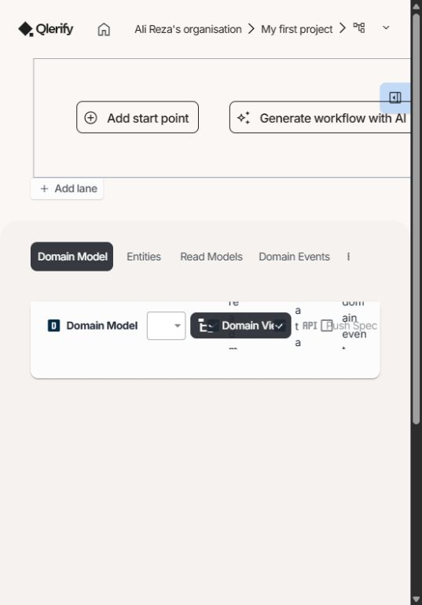
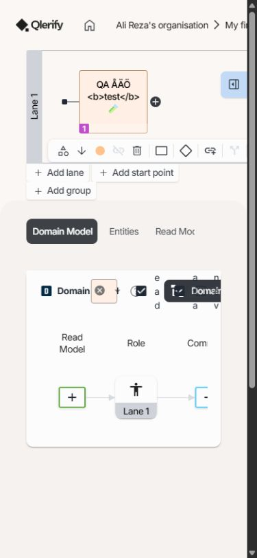
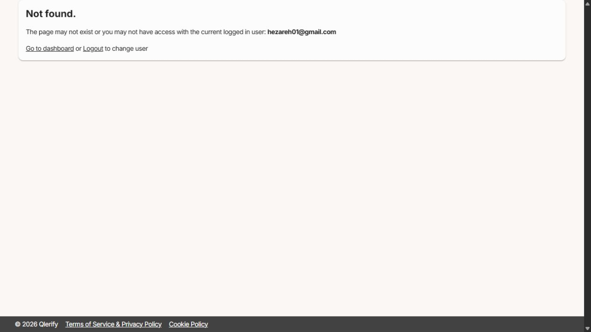
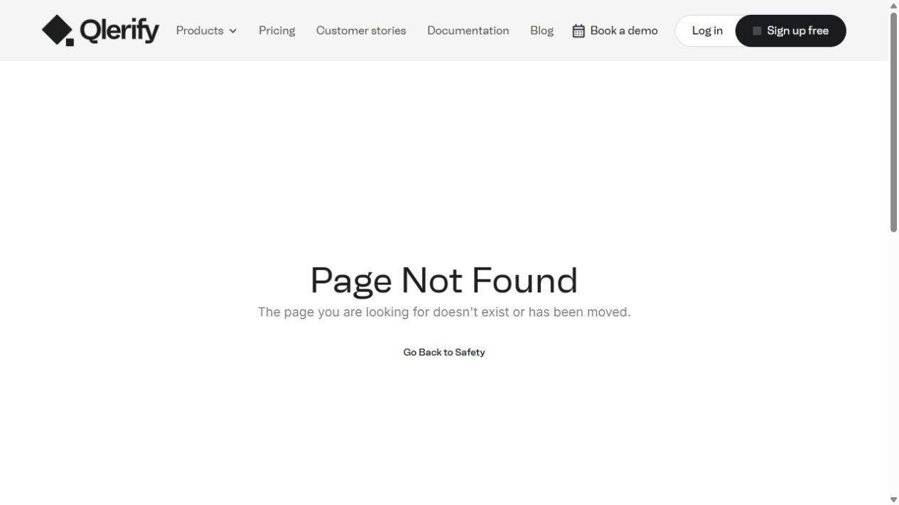
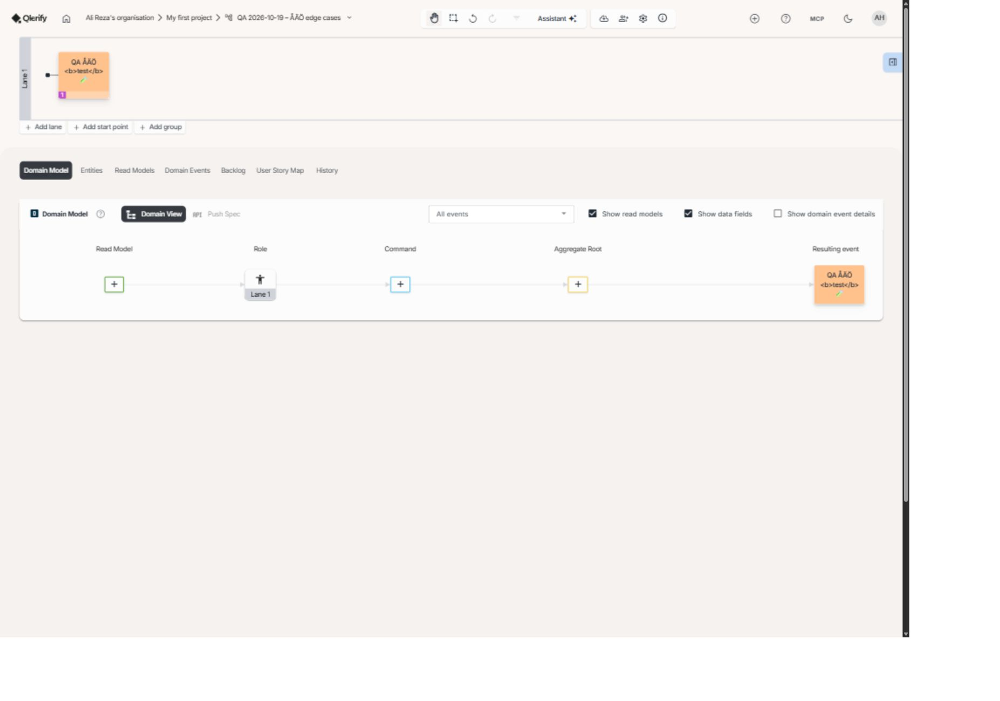

# Testrapport – utforskande granskning av Qlerify-appen

- Rapport-ID: QLERIFY-EXP-2026-10-19-APP
- Datum: 2026-10-19
- Testare och QA-ansvarig: Ali Reza Hezareh
- QA-status: Testerna är inte godkända. Fem avvikelser är öppna.
- Miljö: Qlerifys driftsatta webbapp, Windows och den inbyggda Chromiumbaserade webbläsaren.
- Version: Byggnummer saknades i gränssnittet. Den observerade skriptresursen var `js/app.b135f38b.js`.
- Bildbevis: JPG-filer och DOM-utdrag i `qa/evidence/exploratory-2026-10-19/`.
- Videoinspelning: Ingen video spelades in.

## 1. Sammanfattning

Jag testade appen från en redan inloggad session. Jag skapade ett separat QA-arbetsflöde och provade validering, sparning, ändringshistorik, flikar, sökning, export, skrivskydd och layout.

Fyra nya avvikelser dokumenterades. Det tidigare kända felet på `qlerify.com/login` återkom. Inga Critical- eller High-fel bekräftades i den testade omfattningen. Det innebär inte att sådana fel saknas.

Av 42 körda kontrollpunkter fick 37 Pass och 5 Fail. Ytterligare 3 var Blocked och 4 kördes inte. Kontrollpunkterna dokumenterades under utforskningen; de utgör inte en fullständig regressionssvit eller ett mått på hela produktens täckning.

## 2. Omfattning och testdata

- Dashboard och ett eget QA-arbetsflöde i `My first project`.
- Skapa arbetsflöde, namnvalidering, startpunkt, händelsetext, Ångra och Gör om.
- Manuell entitet, fältnamn, datatyp och beskrivning.
- User Story-kort, Backlog, sökning, User Story Map och History.
- De sju huvudflikarna, omladdning, bakåt och framåt.
- Export Workflow, synliga skrivskyddskontroller och tillstånden Completed/In Progress.
- Layout vid 1440 × 900, 390 × 844 och den ursprungliga panelens 552 × 790 pixlar.
- Tillgängliga namn i DOM och tillgänglighetsträdet. Ingen fullständig granskning med skärmläsare eller kontrastmätning gjordes.

QA-arbetsflödet finns kvar med namnet **QA 2026-10-19 – ÅÄÖ edge cases** och status **In Progress**. Det innehåller en händelse, en entitet och ett User Story-kort. Arbetsflödet som skapades med blanksteg döptes om till detta namn.

[Öppna QA-arbetsflödet](https://app.qlerify.com/workflow/8cc598e8-dd91-497c-aaa1-5e62ac66a36f/e5cb10a6-f061-4c66-a30e-630c6e7b9af3). Det publika Cart-exemplet granskades för synliga skrivskyddskontroller.

## 3. Resultatöversikt

| Mått | Antal |
|---|---:|
| Dokumenterade kontrollpunkter | 49 |
| Körda, Pass + Fail | 42 |
| Pass | 37 |
| Fail | 5 |
| Blocked | 3 |
| Ej körda | 4 |
| Pass rate, 37/42 × 100 | 88,1 % |
| Fail rate, 5/42 × 100 | 11,9 % |

| Severity | Öppna avvikelser |
|---|---:|
| Critical | 0 |
| High | 0 |
| Medium | 2 |
| Low | 3 |

## 4. Detaljerade testresultat

Pass gäller endast det förväntade resultat som står på samma rad. Blocked och Ej körd ingår inte i pass- eller fail-procenten.

| ID | Kontroll | Status | Förväntat | Faktiskt resultat / kommentar | Bug-ID |
|---|---|---|---|---|---|
| EXP-001 | Starta dashboard | Pass | Dashboard visar befintliga arbetsflöden. | Dashboard laddade och visade eget flöde och Cart-exemplet. | – |
| EXP-002 | Tomt arbetsflödesnamn | Pass | Tomt namn stoppas. | Required. visades. Inget arbetsflöde skapades. | – |
| EXP-003 | Namn med tre blanksteg | Fail | Namn utan synliga tecken stoppas. | Ett arbetsflöde med tom synlig rubrik skapades. | APP-001 |
| EXP-004 | Byt arbetsflödesnamn och ladda om | Pass | ÅÄÖ och namn finns kvar. | QA 2026-10-19 – ÅÄÖ edge cases sparades. | – |
| EXP-005 | Skapa startpunkt | Pass | En händelse skapas i testflödet. | New event skapades i Lane 1. | – |
| EXP-006 | Händelsenamn med ÅÄÖ och emoji | Pass | Text sparas efter omladdning. | QA ÅÄÖ `<b>test</b>` 🧪 fanns kvar. | – |
| EXP-007 | HTML-liknande händelsetext | Pass | Texten behandlas som text på ritytan. | `<b>test</b>` visades bokstavligt på ritytan. Aktivt script testades inte. | – |
| EXP-008 | Ångra namnändring | Pass | Tidigare händelsenamn återkommer. | New event återkom. | – |
| EXP-009 | Gör om namnändring | Pass | Det nya händelsenamnet återkommer. | QA-texten återkom efter uppdateringen. | – |
| EXP-010 | Entities utan entiteter | Pass | Ett begripligt tomläge visas. | No Entities created yet och skapainstruktion visades. | – |
| EXP-011 | Skapa entitet manuellt | Pass | En manuell entitet skapas. | New Entity 1 och ett standardfält skapades. | – |
| EXP-012 | Byt entitetsnamn | Pass | Namn med ÅÄÖ och emoji sparas. | QA Kund ÅÄÖ 🧪 fanns kvar efter omladdning. | – |
| EXP-013 | Byt entitetsfältets namn | Pass | Nytt fältnamn sparas. | QA antal fanns kvar efter omladdning. | – |
| EXP-014 | Byt datatyp till Number | Pass | Vald typ sparas. | Number visades efter omladdning. Värdevalidering testades inte. | – |
| EXP-015 | Spara entitetsbeskrivning med Enter | Pass | Beskrivningen sparas med ÅÄÖ och specialtecken. | Beskrivningen fanns kvar efter omladdning. | – |
| EXP-016 | Skapa och redigera User Story-kort | Pass | Kortets nya text sparas. | QA-text med ÅÄÖ och emoji sparades och återkom efter omladdning. | – |
| EXP-017 | Kortets koppling till Backlog | Pass | Samma kort och rätt händelse visas. | Kortet visades med Lane 1 och rätt händelsenamn. | – |
| EXP-018 | Backlog-sökning utan träff | Pass | Kort som inte matchar döljs. | Sökningen NO-MATCH-QA-2026 gav inga kortrader. | – |
| EXP-019 | Backlog-sökning med ÅÄÖ | Pass | Matchande kort hittas. | En matchande kortrad visades. | – |
| EXP-020 | User Story Map visar kortet | Pass | Samma User Story visas i kartan. | QA-kortet visades under No release assigned. | – |
| EXP-021 | Bevarad flik efter omladdning | Pass | User Story Map förblir vald. | aria-selected var true efter omladdning. | – |
| EXP-022 | Domain Events utan domänkort | Pass | Tomt resultat visas utan krasch. | Not linked to entity 0 visades. | – |
| EXP-023 | Read Models utan läsmodeller | Pass | Tomt resultat visas utan krasch. | Not linked to entity 0 visades. | – |
| EXP-024 | Historiksökning utan träff | Pass | Ett tomläge visas. | No data available visades för en obefintlig tagg. | – |
| EXP-025 | Rensa historiksökning | Pass | Historikraderna kommer tillbaka. | Raden created workflow visades igen. | – |
| EXP-026 | Öppna samtliga huvudflikar | Pass | Alla sju huvudflikar går att öppna. | Domain Model, Entities, Read Models, Domain Events, Backlog, User Story Map och History öppnades. | – |
| EXP-027 | Webbläsarens bakåtknapp | Pass | Föregående flik och URL återkommer. | Domain Events och selectedTab=3 återkom. | – |
| EXP-028 | Webbläsarens framåtknapp | Pass | Nästa flik och URL återkommer. | User Story Map och selectedTab=5 återkom. | – |
| EXP-029 | Export Workflow | Pass | En exportfil laddas ner. | En .qlerify-fil laddades ner. JSON-omslaget innehöll iv och ciphertext. Innehållets återimport är inte verifierad. | – |
| EXP-030 | Villkorslänk från händelsedetalj | Fail | Dokumentet med villkor öppnas. | Länken gick till /workflow/Qlerify_terms_of_service_and_privacy_policy.pdf och sedan /404. | APP-003 |
| EXP-031 | Tillgängliga namn på ikonknappar | Fail | Ikonknappar har beskrivande namn. | Fyra synliga kontroller hade tomt tillgängligt namn. Tre hade en separat beskrivning. | APP-004 |
| EXP-032 | Domänmodellens verktygsfält på smal skärm | Fail | Etiketter och kontroller går att läsa och använda utan överlappning. | Kontroller överlappade och etiketter bröts till enstaka bokstäver vid 390 och 552 pixlars bredd. | APP-002 |
| EXP-033 | Escape i New Workflow | Pass | Dialogen stängs. | Dialogen stängdes utan att skapa data. Fokus återgick till dokumentets body. | – |
| EXP-034 | Cancel i New Workflow | Pass | Det inskrivna namnet sparas inte. | QA CANCEL – ska inte sparas skapades inte som arbetsflöde. | – |
| EXP-035 | Öppna hjälpen | Pass | Dashboardhjälp visas. | Home Dashboard-dialogen med vägledning öppnades. | – |
| EXP-036 | Hjälplänk User Story Mapping | Pass | Rätt publika hjälpsida öppnas. | /user-story-mapping skickade vidare till /user-story-mapping-tool. | – |
| EXP-037 | Skrivskyddat Cart-exempel | Pass | Redigering av synliga händelser och läsmodelltyp är avstängd. | View only mode visades. Händelsens add och Single Item var avstängda. Inga contenteditable=true fanns. Serverbehörighet testades inte. | – |
| EXP-038 | Skrivskyddets flik efter omladdning | Pass | Read Models och avstängd Single Item finns kvar. | selectedTab=2 och aria-selected=true återkom. Knappen var fortfarande avstängd. | – |
| EXP-039 | Completed låser QA-arbetsflödet | Pass | Ändringskontroller låses och tillståndet sparas. | This workflow is locked visades efter omladdning. Händelsens add var avstängd och redigerbara textfält saknades. | – |
| EXP-040 | Add lane när QA-arbetsflödet är låst | Pass | Ingen ny bana sparas. | Knappen såg aktiv ut men ingen Lane 2 skapades. Resultatet var oförändrat efter omladdning. | – |
| EXP-041 | Återgå till In Progress | Pass | QA-arbetsflödet kan redigeras igen. | Namnfältet var redigerbart igen efter omladdning. | – |
| EXP-042 | Publika adressen qlerify.com/login | Fail | Inloggningen öppnas eller adressen skickar vidare. | Page Not Found visades. Det är samma kända fel som i tidigare rapport. | QW-001 |
| EXP-043 | Lösenordsinloggning och utloggning | Blocked | Kontoinnehavaren genomför inloggning och utloggning. | Testet behöver genomföras av kontoinnehavaren. Befintlig session användes i denna granskning. | – |
| EXP-044 | API-behörighet, roller och IDOR | Blocked | Åtkomst följer en fastställd rollmatris. | Två kontrollerade testkonton och en rollmatris saknades. | – |
| EXP-045 | Belastning och prestandagränser | Blocked | Svarstid och stabilitet mäts mot beslutade gränser. | Avgränsad testmiljö, belastningsbudget och prestandakrav saknades. | – |
| EXP-046 | Filuppladdning och ogiltiga filer | Ej körd | Tillåtna och otillåtna filer hanteras korrekt. | Inte utfört i denna session. | – |
| EXP-047 | Återimport av exportfil | Ej körd | Exporterad data kan återställas utan förlust. | Exporten laddades ner. Återimport och jämförelse utfördes inte. | – |
| EXP-048 | Permanent radering och återställning | Ej körd | Radering och återställning följer produktens regler. | Permanent radering och återställningsflöde utfördes inte. | – |
| EXP-049 | Integrationer och inbjudningar | Ej körd | Integrationer och delning följer bestämd åtkomst. | Jira, Azure DevOps, externa kopplingar och utskick testades inte. | – |

## 5. Buggrapporter

### APP-001 – Ett arbetsflöde kan skapas med bara blanksteg

- Severity: Low
- Priority: P2
- Status: Öppen, ny avvikelse.
- Risk: Arbetsflödet saknar ett synligt namn och blir svårt att identifiera.

Steg för att återskapa:

1. Öppna dashboarden och klicka på New Workflow.
2. Välj ett projekt.
3. Ersätt Workflow name med exakt tre blanksteg (`   `).
4. Klicka på Add.

Förväntat: Samma obligatoriska namnkontroll som för ett tomt fält ska stoppa namnet.

Faktiskt: Ett nytt arbetsflöde skapades och rubriken blev tom. Den tomma strängen stoppades med `Required.`, men tre blanksteg accepterades.

Möjlig grundorsak: Valideringen kan sakna kontroll av innehållet efter trimning. Applikationskoden granskades inte.

### APP-002 – Domänmodellens verktygsfält överlappar på smal skärm

- Severity: Medium
- Priority: P2
- Status: Öppen, ny avvikelse. Kravet på stödda skärmstorlekar är inte fastställt.
- Risk: Etiketter och val blir svåra att läsa och skilja åt.

Steg för att återskapa:

1. Öppna ett arbetsflöde med en händelse.
2. Öppna Domain Model.
3. Stäng den högra detaljpanelen.
4. Använd en visningsyta på 390 × 844 pixlar. Problemet observerades även vid 552 × 790.
5. Granska Domain View, händelsevalet och kryssrutornas etiketter.

Förväntat: Verktygsfältets vanliga formulärkontroller och etiketter ska gå att läsa utan att överlappa.

Faktiskt: Kontroller överlappar och etiketterna bryts till enstaka bokstäver. Granskningen avser verktygsfältet; stora tvådimensionella diagram kräver en separat bedömning.

Möjlig grundorsak: Grundorsaken är inte fastställd. CSS-koden granskades inte.

[Layoutmått](../evidence/exploratory-2026-10-19/APP-002-layout.json). Referens för vanliga kontrollers omflöde: [WCAG 2.2, 1.4.10](https://www.w3.org/WAI/WCAG22/Understanding/reflow.html).

### APP-003 – Villkorslänken ger 404 från en händelses detaljadress

- Severity: Low
- Priority: P2
- Status: Öppen, ny avvikelse.
- Risk: Användaren kommer inte åt villkorsdokumentet från denna vy.

Steg för att återskapa:

1. Öppna QA-arbetsflödet.
2. Klicka på dess händelse så att händelse-ID läggs till sist i adressen.
3. Följ sidfotens Terms of Service & Privacy Policy.

Förväntat: Villkorsdokumentet öppnas oavsett vilken arbetsflödesvy som används.

Faktiskt: Den observerade länken var `../../Qlerify_terms_of_service_and_privacy_policy.pdf`. Från händelsens adress blev målet `https://app.qlerify.com/workflow/Qlerify_terms_of_service_and_privacy_policy.pdf`. Appen skickade vidare till `/404` och visade `Not found.`.

Observerad grundorsak i DOM: Den relativa sökvägen beror på hur många segment den aktuella adressen har. Detta förklarar det felaktiga länkmålet. Serverns implementation granskades inte.

[Länkmål och feltext](../evidence/exploratory-2026-10-19/APP-003-terms-link.txt).

### APP-004 – Fyra ikonknappar saknar tillgängligt namn

- Severity: Medium
- Priority: P2
- Status: Öppen, ny avvikelse.
- Risk: Kontrollerna saknar ett beskrivande namn i tillgänglighetsträdet. Påverkan med en viss skärmläsare är inte testad.

Steg för att återskapa:

1. Öppna det redigerbara QA-arbetsflödet på bred skärm.
2. Granska knapparnas namn i tillgänglighetsträdet.
3. Kontrollera handverktyget, markeringsverktyget, förklaringsknappen och banans menyknapp.

Förväntat: Varje knapp har ett beskrivande tillgängligt namn.

Faktiskt: De fyra kontrollerna matchade `button` med tomt tillgängligt namn. Tre hade separata beskrivningar: Hand tool, Pointer tool och View the legend for the workflow. Banans meny saknade även sådan beskrivning.

Observerad grundorsak i DOM: De första tre använder ikonmarkup och `aria-describedby`, men saknar namn via text, `aria-label` eller `aria-labelledby`. Beskrivning och namn är olika egenskaper.

[DOM-bevis för de fyra knapparna](../evidence/exploratory-2026-10-19/APP-004-unnamed-buttons.json). Kravreferens: [WCAG 2.2, 4.1.2 Name, Role, Value](https://www.w3.org/WAI/WCAG22/Understanding/name-role-value.html).

### QW-001 – qlerify.com/login visar Page Not Found

- Severity: Low
- Priority: P2
- Status: Tidigare känt fel, reproducerat igen.
- Risk: Den som följer denna inloggningsadress hamnar på en felsida.

Steg för att återskapa:

1. Öppna `https://qlerify.com/login`.
2. Vänta tills sidan har laddat.

Förväntat: Inloggningen öppnas eller användaren skickas vidare till appens inloggningssida.

Faktiskt: Adressen blev `https://www.qlerify.com/login`. Sidan visade `Page Not Found` och att sidan saknas eller har flyttats. Sidans Log in-länk pekade på `https://app.qlerify.com/login`.

Grundorsak: Inte fastställd.

## 6. Övriga observationer och begränsningar

- Konsolen innehöll `Subscription error: Object` och `[HelpHero] Error: Inactive app`. Ingen tydlig funktionspåverkan kopplades till dessa loggar. De räknas inte som separata produktbuggar.
- Vid redigering visades en varning om att en annan användare hade ändrat objektet. En fullständig samtidighetstestning gjordes inte. Sparning med uttrycklig bekräftelse kontrollerades genom omladdning.
- Add lane såg aktiv ut även i låst läge. Det godkända testförsöket i QA-arbetsflödet skapade ingen bana. Ingen låsförbikoppling bekräftades.
- Exportfilen kunde läsas som JSON med `iv` och `ciphertext`. Modellens innehåll kunde därför inte jämföras som klartext. En lyckad nedladdning bevisar inte en lyckad återimport.
- Typvalet Number sparades. Negativa tal, decimaler, gränsvärden och databasregler verifierades inte genom detta test.
- HTML-liknande text granskades som text på ritytan. Ingen aktiv lagrad XSS, SQL-injektion, tokenmanipulation eller behörighetsbypass bekräftades.
- Lösenordsinloggning, utloggning, verklig serverbehörighet mellan två användare, nätverksavbrott, flera samtidiga redigerare och större datamängder återstår.
- Inga tillförlitliga mätningar av svarstid, CPU, minne eller belastningskapacitet gjordes. Verktygets väntetid räknas inte som produktens svarstid.

[Sparade konsolloggar](../evidence/exploratory-2026-10-19/TC-console-errors.json). [Kontrollsumma och format för exporten](../evidence/exploratory-2026-10-19/TC-export-summary.json). Själva exportfilen finns lokalt i Downloads och ingår inte i rapportpaketet.

## 7. Kvalitetsbedömning och avvikelser

Underlaget räcker inte för ett releasegodkännande. Fem kontrollpunkter fick Fail. Ytterligare sju var blockerade eller kördes inte. De provade kärnflödena för skapande, sparning, sökning, Ångra/Gör om och tillståndslåsning fungerade i den angivna omfattningen.

Detta var en utforskande session i den driftsatta appen. Fullständig API-, databas-, säkerhets-, tillgänglighets- och prestandatestning genomfördes inte. Resultatet ska inte ersätta hela gruppens regressionsresultat.

QA-ansvarig: **Ali Reza Hezareh – testerna är inte godkända, 2026-10-19.**

## 8. Sparat tillstånd efter testerna

QA-arbetsflödet lämnades i In Progress. Testnamn, entitet och kort finns kvar så att resultaten går att granska. Ingen permanent radering gjordes.

